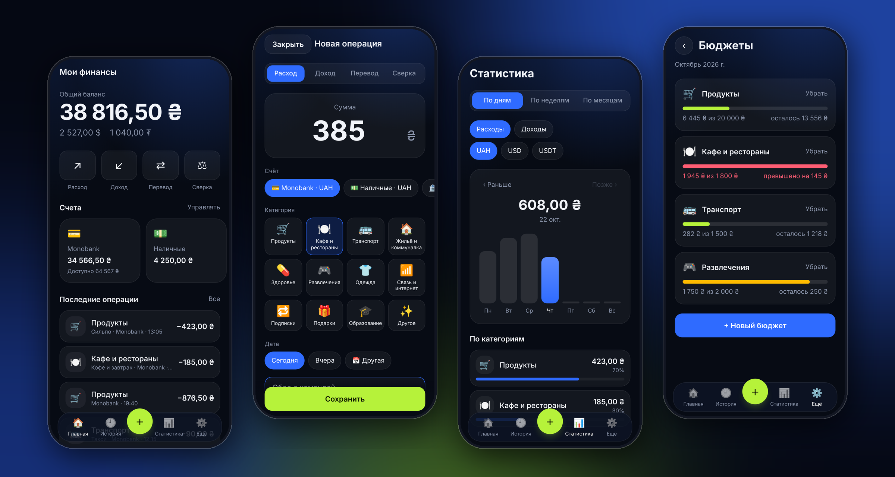
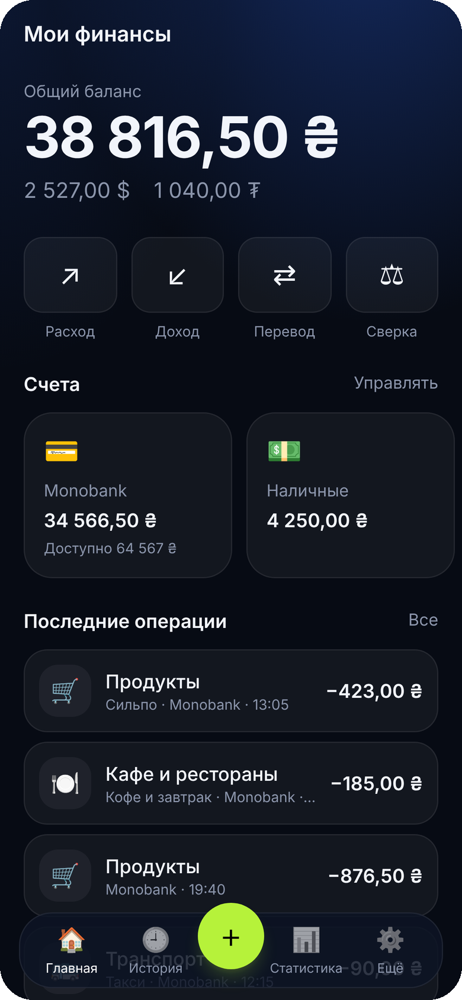
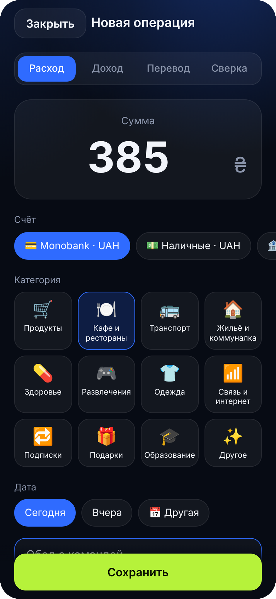
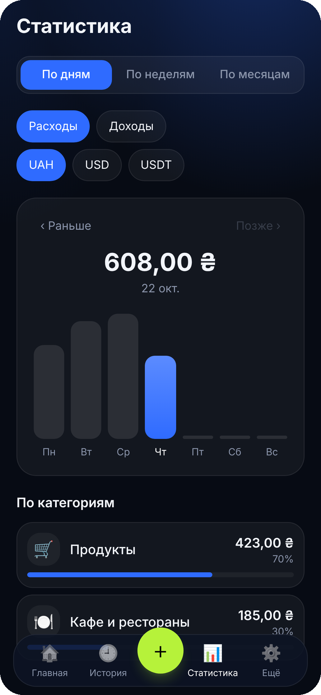
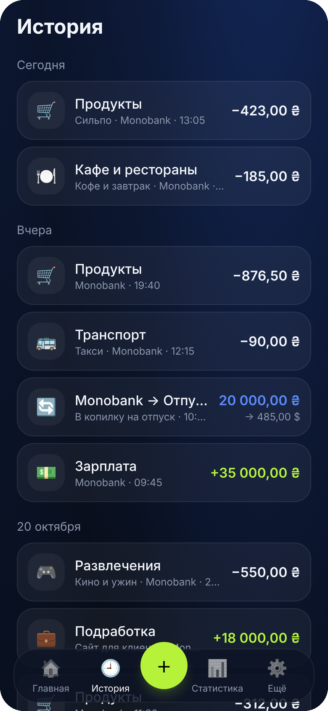
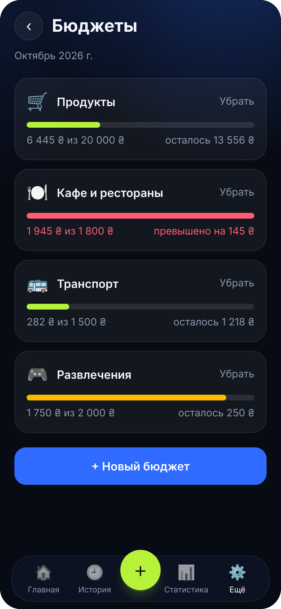
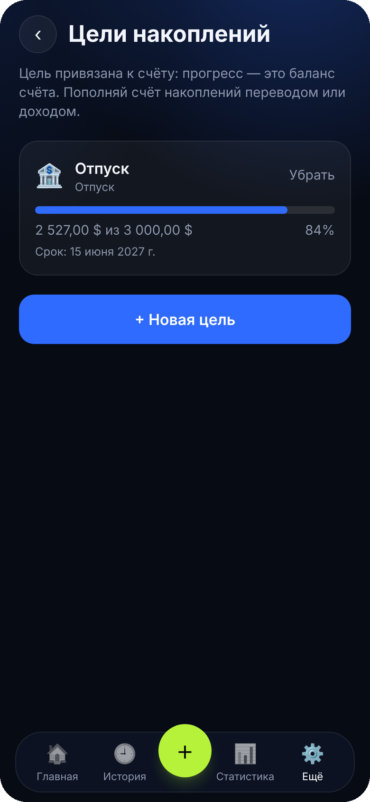
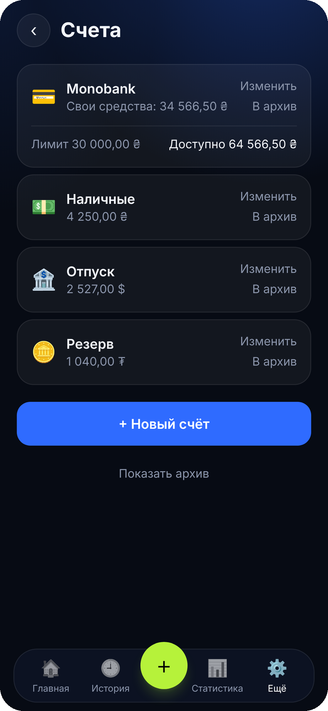

<div align="center">


# Мои финансы

**Личный трекер расходов и накоплений в духе ZenMoney.**
Тёмная тема, русский интерфейс, данные в облаке, ставится на экран «Домой» как обычное приложение.


<br />



</div>

<br />

## Возможности

**Деньги и счета**
- Счета в **UAH, USD и USDT**: наличные, карты, накопления, крипто
- **Кредитный лимит** на карте: видно свои средства и доступную сумму вместе с лимитом
- Расходы, доходы, **переводы между счетами** (в том числе между разными валютами, с суммой зачисления)
- **Сверка баланса**: вводишь фактическую сумму, приложение само считает разницу
- Архив счетов: история сохраняется, счёт не мешает

**Планирование**
- **Статистика** по дням, неделям и месяцам с разбивкой по категориям
- **Бюджеты** по категориям на месяц: полоска прогресса и предупреждение при 80% и при превышении
- **Цели накоплений**, привязанные к счёту: прогресс равен балансу счёта, никаких отдельных взносов

**Удобство**
- Работает как приложение: иконка на экране «Домой», полноэкранный режим, быстрый запуск
- Чтение работает **без сети** (кэш), записи требуют интернета
- Вход один раз на устройство, сессия живёт долго
- Экспорт всех данных одним JSON-файлом
- Все периоды считаются по Киеву, неделя начинается с понедельника

<br />

## Скриншоты

> Данные на скриншотах демонстрационные.

<table>
  <tr>
    <td align="center" width="25%"><br /><sub><b>Главная</b><br />баланс по валютам, счета</sub></td>
    <td align="center" width="25%"><br /><sub><b>Новая операция</b><br />сумма, счёт, категория</sub></td>
    <td align="center" width="25%"><br /><sub><b>Статистика</b><br />по дням, неделям, месяцам</sub></td>
    <td align="center" width="25%"><br /><sub><b>История</b><br />операции по дням</sub></td>
  </tr>
  <tr>
    <td align="center" width="25%"><br /><sub><b>Бюджеты</b><br />лимиты и превышения</sub></td>
    <td align="center" width="25%"><br /><sub><b>Цели накоплений</b><br />прогресс по счёту</sub></td>
    <td align="center" width="25%"><br /><sub><b>Счета</b><br />кредитный лимит и доступно</sub></td>
    <td></td>
  </tr>
</table>

<br />

## Как устроено

| Слой | Что используется |
|---|---|
| Интерфейс | React, TypeScript, Vite, Tailwind CSS, React Router |
| Данные на клиенте | TanStack Query, кэш в IndexedDB для чтения без сети |
| PWA | `vite-plugin-pwa`: манифест, service worker, плашка «Доступна новая версия» |
| Бэкенд | Supabase: Postgres, авторизация, Row Level Security |
| Хостинг | Vercel (подойдёт и Cloudflare Pages) |

Ключевые решения:

- **Деньги хранятся в копейках** (`bigint`), чтобы не ловить ошибки округления.
- **Баланс не хранится**, а считается из операций, поэтому не может «разъехаться».
- **Перевод это одна строка** с двумя суммами: списано и зачислено. Курс не хранится, он равен отношению сумм.
- **Доступ к данным защищён на уровне базы**: у каждой строки есть владелец, и политики RLS не дают читать чужое.

Подробнее: [docs/ARCHITECTURE.md](docs/ARCHITECTURE.md).

<br />

## Быстрый старт

Понадобятся Node.js 22 и бесплатный аккаунт на [supabase.com](https://supabase.com).

**1. База данных.** Создай проект в Supabase, открой **SQL Editor → New query**, вставь содержимое [`supabase/paste.sql`](supabase/paste.sql) и нажми **Run**. Файл уже включает все миграции.

> Если база создана раньше и в ней нет кредитного лимита, выполни только [`supabase/paste-0002.sql`](supabase/paste-0002.sql).

**2. Настройки входа.** В **Authentication → Sign In / Providers → Email** выключи **Confirm email**, чтобы не зависеть от почты.

**3. Ключи.** Скопируй `.env.example` в `.env` и заполни из **Project Settings → API**:

```bash
VITE_SUPABASE_URL=https://xxxxxxxx.supabase.co
VITE_SUPABASE_ANON_KEY=sb_publishable_...
```

**4. Запуск.**

```bash
npm install
npm run dev
```

**5. Первый вход.** На экране входа нажми «Первый запуск? Создать аккаунт» и задай почту и пароль. Сразу после этого **отключи регистрацию** (Authentication → Sign In / Providers → выключи *Allow new users to sign up*), чтобы никто чужой не создал аккаунт.

<br />

## Деплой

**Vercel**
1. Зайди на [vercel.com](https://vercel.com) через GitHub, нажми **Add New → Project** и выбери этот репозиторий.
2. Настройки определятся сами: build `npm run build`, output `dist`.
3. В **Environment Variables** добавь `VITE_SUPABASE_URL` и `VITE_SUPABASE_ANON_KEY` и нажми **Deploy**.

`vercel.json` уже настроен: переходы по внутренним ссылкам работают, service worker не кэшируется. На Cloudflare Pages всё то же самое: build `npm run build`, output `dist`, файл `public/_redirects` уже лежит в репозитории.

**Установка на iPhone.** Открой сайт в Safari → «Поделиться» → «На экран Домой». Дальше запускай приложение с иконки.

<br />

## Бэкапы и защита от «засыпания»

На бесплатном тарифе Supabase нет автоматических бэкапов, а проект замораживается после 7 дней без активности. Для этого в [`.github/workflows`](.github/workflows) настроены два задания. Добавь в репозитории секреты (**Settings → Secrets and variables → Actions**):

| Секрет | Зачем |
|---|---|
| `SUPABASE_URL`, `SUPABASE_ANON_KEY` | пинг раз в 3 дня, чтобы проект не засыпал |
| `SUPABASE_DB_URL` | еженедельный дамп базы, сохраняется как артефакт на 90 дней |

Дополнительно в приложении есть ручной экспорт: **Ещё → Экспорт данных (JSON)**.

<br />

## Структура проекта

```text
src/
  pages/        экраны: Главная, История, Статистика, Счета, Бюджеты, Цели, Вход
  components/   форма операции, навигация, уведомления, плашка обновления
  lib/          работа с Supabase, деньги, даты (часовой пояс Киева), типы
  auth/         контекст авторизации
supabase/
  migrations/   схема базы по шагам
  paste.sql     вся схема одним файлом для SQL Editor
docs/           архитектура и скриншоты
.github/        бэкап и keep-alive
```

<br />

## Планы

- Push-уведомления: вечернее напоминание внести траты
- Теги к операциям (таблицы в базе уже есть)
- Запись операций без сети с отправкой при появлении интернета
- Конвертация валют по курсу для общего баланса
